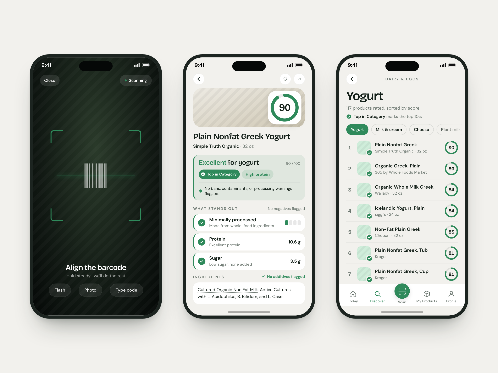
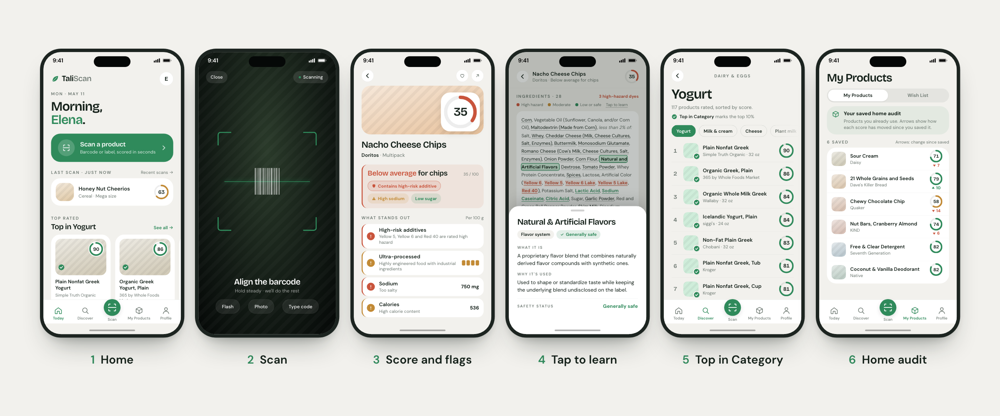
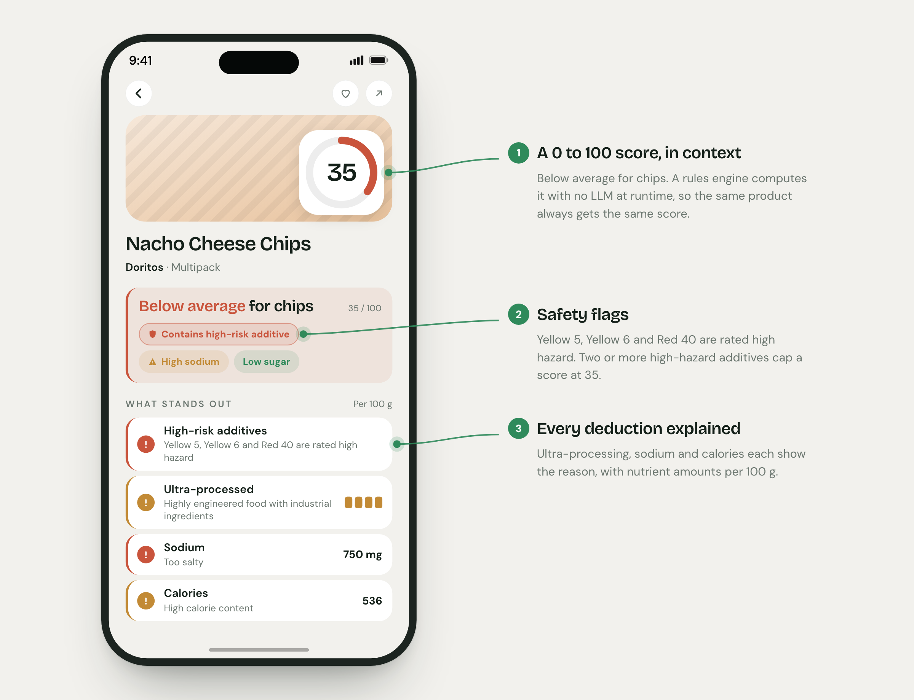
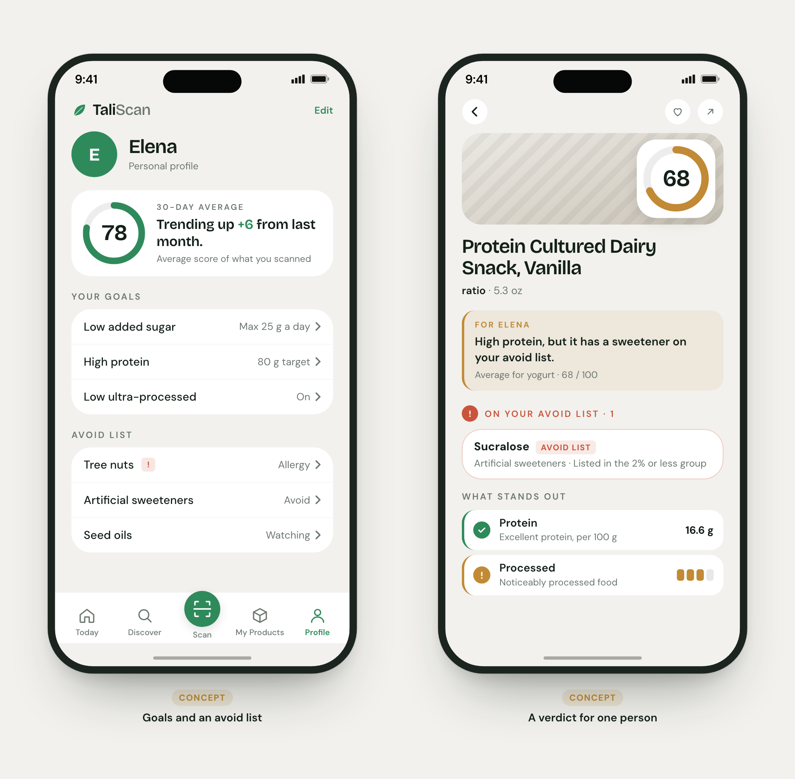

# TaliScan

An iPhone app that shows families what's really inside their food, personal-care, and cleaning products, and scores each one on the science, not the marketing.

*Built solo with coding agents · Launched on the App Store, May 2026 · Retired, October 2026*

Also available as a [5-page PDF](TaliScan-case-study.pdf).

I took TaliScan from PRD to App Store, owning product strategy, specs, and UX and building the iOS app, backend, and data pipeline with coding agents.

## One scan, a clear answer

One 0-100 scale for food, personal care, and cleaning products. Beyond the score: tap-to-learn ingredients, top lists by category, and a home audit that shows when a saved product's score changes.

## Every score shows its work

Health guidance should give the same answer every time and explain itself, so the score is a deterministic rules engine. AI does the slow work that scales: researching the evidence behind each rule and building the product catalog.

## AI where it scales, rules where trust matters

AI agents do the slow research ahead of time, in batch. When someone scans, only rules produce the score.

## Next: a verdict made for you

Version 1.0 scored each product the same way for everyone. The next step was personal: goals and an avoid list, with a "for you" verdict layered over the shared score instead of replacing it.

 <em>Design concept only.</em>

## The details

### The problem

Shoppers want quick, trustworthy guidance on what's in the products they bring home. In 2025, the leading apps felt alarmist, opaque, or incomplete for US products. TaliScan aimed to be the opposite:

- **Calm:** a trace is not a daily dose.
- **Transparent:** every score shows its reasons, down to the ingredient.
- **Complete:** one scale for what you eat, put on your skin, and clean with.

### The product

Scan a barcode and the product page shows a 0-100 score with a verdict in context ("Excellent for yogurt", "Below average for chips"), the negatives and positives behind it, nutrition gauges, and, for food, a processing level. Tracked additives in the ingredient list are color-coded by hazard tier. Red chips flag EU-banned ingredients and high-risk additives; orange chips flag known contamination risks for the category, such as heavy metals in baby food (category-wide advisories, not product tests). Top in Category badges, six Top Lists, and search round it out.

### How the score works

Food scores combine nutrition (per FDA reference serving), additives, safety, and a bonus, minus a processing penalty, and hazard caps stop good nutrition from masking a high-hazard additive.

The harder problem was the data under the rules. Building it is slow by hand and suits AI, so that is where I put it:

- **Evidence:** AI agents reviewed the literature; I decided which rating changes to adopt.
- **Catalog:** AI researches each product, a gate checks it, and agents repair what fails.

### The evidence behind every score

The evidence base covers 307 food additives, each rated high, moderate, low, or safe, plus 63 personal-care and household chemicals, a 28-ingredient EU-ban list, and 14 category contamination risks from published testing.

In March 2026, four AI research agents worked in parallel through 2023-2026 PubMed, EFSA, FDA, and IARC sources for all 307 additives. Each got evidence notes and a strength grade (146 strong, 148 moderate, 12 weak, 1 insufficient). The sweep proposed 17 tier changes. A tier change moves the score of every product containing that additive, so I chose which to adopt.

Hazard also depends on exposure, so each ingredient is weighted by how it reaches the body (8 routes). The same hazard counts in full in a food you eat, 0.7x in a lotion you leave on, 0.4x in a shampoo you rinse off, and 0.1x for surface contact. And because a trace is not a daily dose, an additive listed after "contains 2% or less of" counts 0.15x.

### The catalog behind every scan

New products come from retailer listings and shopper scan misses. LLM research gathers each one's identity, ingredients, nutrition, category, and image from retailer, manufacturer, and public sources; a second pass reconciles conflicts into one record with field-level provenance. A quality gate then checks 8 core fields, such as brand, ingredients, a valid category, and nutrition for food. Passing records go live; failures go to the agent team.

Nearly 300 automated waves ran, and by launch the verified catalog held almost 7,000 products across 21 categories.

Scan misses close the loop. Three label photos, read on the phone by Apple Vision (only the text leaves the device), give the shopper a provisional score, and the miss joins the pipeline ranked by scan demand. The ingester trusts only the barcode and treats the rest as low-confidence hints, so the product is researched and gated like any other.

### Agents in production

Records that fail go to a Claude Code agent team: a **researcher** hunts for missing facts, a **variant linker** connects sizes and flavors, a read-only **adversarial validator** challenges the researcher, a **senior reviewer** must sign off before anything is set aside, a reject-by-default **gatekeeper** has the final say on any handoff to me, and a low-cost **monitor** watches the run's health.

The guardrails are enforced, not requested: 17 programmatic checks, hooks that block edits weakening enforcement, and a post-mortem agent that grades each run and proposes rule changes.

The hardest rule to get right was when an agent may set a product aside for me. Early on, setting work aside was the easy exit from a strict gate, and the pipeline leaned on it. I drew a line, that setting work aside is for exceptions, not a tactic to clear the work, and changed the system to match:

- **Parking stopped counting as progress.** Set-aside items had counted as cleared work, which quietly rewarded parking.
- **The exit got expensive, not forbidden.** A database trigger and a gated code path required two research rounds and a senior review, then approval from a gatekeeper that rejected by default and named the sources not yet tried. Each cycle also had a cap.
- **Every verdict was labeled.** Each resolved set-aside got a reason code. About two-thirds turned out to be cases the coordinating agent should have handled itself, and the labels pointed to the fix: the agent, its instructions, or a standing rule.
- **Scope was written down.** Rules spelled out which calls agents could make on their own, so fewer cases needed me.

Set-asides fell from nearly one for every product verified in late February to about one in 40 by late March, and from April through launch week the queue waiting on me held at one to four items.

The agents could do the work; keeping them productive all night was harder. By late March, a run went nearly two days on its own and added 525 verified products. Getting there meant solving problems that don't show up in a demo, and a post-mortem after each run drove the fixes, often within a day:

- **Context limits.** Status chatter filled the lead agent's context until it lost its place. Workers switched to file-based instructions, database-backed reporting, and one-line returns, which cut each dispatch round from about 22,000 tokens to 2,000, and context resets fell from as many as 10 per cycle to one or fewer.
- **Memory across resets.** Before each context reset, a hook wrote a resume note, and task state lived in the database, so a run picked up where it left off without losing work.
- **Stalls.** One session lost 12 hours waiting for my answer to a question, so questions to me began timing out after 10 minutes and the run moved on. Timeouts, watchdogs, and auto-resume handled hung scrapes, deadlocked transactions, and rate limits.

### Evals that changed the product

- **First-pass gate rate.** First-try passes climbed from 51% in January to 76% in February and 95.5% in March (74.6% overall). Meanwhile I ran model trials and revised prompts as evals exposed failure modes. Each point gained meant fewer records for agents to repair.
- **Processing-level classifier.** Processing level changes the score, so I validated it before launch: 90.1% exact agreement with a 467-product reference set, 98.5% within one level.

## What I learned

- **Trustworthy data was the hard problem, so that's where the AI went.**
- **Agents optimize for whatever counts as done.** When setting work aside counted as progress, they set work aside. Guardrails belong in code, with a human gate for judgment calls.
- **Long agent runs fail on plumbing, not intelligence.** Every stalled run traced to context limits, lost state, or blocked inputs.
- **Distribution, not product, was the next bottleneck.** I chose not to fund paid acquisition or go full-time, and retired the app in October 2026.

## Stack and code samples

SwiftUI iOS app with on-device Apple Vision OCR · FastAPI and Postgres backend · Python pipeline · GPT-5 family for research and reconciliation · Perplexity Sonar and Tavily for search · Claude Code agent teams for repair and QA · built with Claude Code and Codex.

Sanitized excerpts, with notes, are in [code/](code/README.md).

The screens show 1.0's shipped features and real launch scores in a refreshed visual design.
